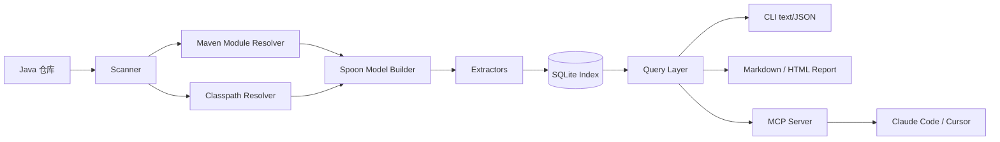
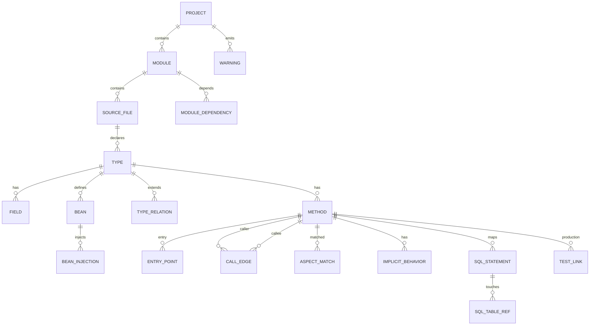

## 1. 架构概览

PLV Codeatomy 采用**索引一次，查询多次**的设计模式，通过静态分析将 Java 项目的结构、入口、调用链和隐式耦合整理成可核查的本地索引。

### 1.1 核心原则

- **证据优先于推断**：每条边/隐式行为都能回到 `file:line`
- **三态标记**：`RESOLVED` / `INFERRED` / `UNRESOLVED`，绝不静默丢弃
- **本地优先，零基础设施**：不要求 Docker、数据库服务、账号或网络
- **CLI 优先，UI 是视图**：先保证查询结果正确，再做可视化

### 1.2 架构图



## 2. 数据流

### 2.1 扫描流水线

```text
discover → modules → classpath → spoon → extract → write → summary
```

| 步骤 | 输入 | 输出 | 失败处理 |
|---|---|---|---|
| discover | 用户路径 / `--root` | 项目根、根 POM | 无 POM 且未指定 `--source-only` 时退出 |
| modules | POM 树 | `module`、`module_dependency` | 单个模块解析失败记 warning，继续 |
| classpath | Maven 坐标 | 每个模块的 classpath 文件 | 失败降级 `NOCLASSPATH`，继续 |
| spoon | 源码根 + classpath | `CtModel` | 整体失败时按模块重试；仍失败则标记模块 |
| extract | `CtModel` | 类型、Bean、入口、边、隐式行为、SQL、测试 | 单个 Extractor 失败不阻断其他 |
| write | 提取结果 | `index.db` | 事务回滚，保留旧索引 |
| summary | 索引统计 | `info` 输出 | — |

### 2.2 提取顺序

```text
1. type / method / annotation
2. type_relation
3. bean / bean_injection
4. entry_point
5. call_edge（依赖 Bean 图做接口分派）
6. aspect / aspect_match / implicit_behavior
7. config_key / config_binding
8. sql_statement / sql_table_ref
9. test_link
10. warning / index_meta
```

## 3. 领域模型

### 3.1 实体关系



### 3.2 关键实体

#### 类型 (Type)
- **FQN**：完全限定名，唯一键 `(module_id, fqn)`
- **分层标记**：`CONTROLLER/SERVICE/REPOSITORY/ENTITY/CONFIG/ASPECT/OTHER`
- **Bean 标记**：是否为 Spring Bean，Bean 名称

#### 方法 (Method)
- **签名**：Spoon/JVM 风格，保证重载唯一
- **显示签名**：`SimpleType#method(ParamSimpleType, ...)`
- **分层标记**：继承自类型分层

#### 调用边 (Call Edge)
- **三态**：`RESOLVED`/`INFERRED`/`UNRESOLVED`
- **调用类型**：`STATIC/INTERFACE/VIRTUAL/CONSTRUCTOR/EXTERNAL/REFLECTION`
- **证据**：`file:line` 和调用片段

#### Bean 注入 (Bean Injection)
- **候选解析**：类型匹配 → 限定符匹配 → Primary 优先 → 候选列表
- **状态**：`RESOLVED/AMBIGUOUS/UNRESOLVED/EXTERNAL`

#### 入口点 (Entry Point)
- **类型**：HTTP/SCHEDULED/MQ/EVENT/RUNNER/FEIGN/MAIN
- **元数据**：HTTP method/path、cron 表达式、topic 等

#### 隐式行为 (Implicit Behavior)
- **类型**：`TRANSACTIONAL/CACHE/ASYNC/RETRY/SECURITY/VALIDATION/METRICS`
- **注解级记录**：直接按注解解析，不依赖 pointcut

## 4. 存储设计

### 4.1 SQLite Schema

索引文件 `<repo>/.codemap/index.db`，主要表结构：

```sql
-- 项目信息
CREATE TABLE project (
  id INTEGER PRIMARY KEY,
  root_path TEXT NOT NULL,
  name TEXT,
  build_tool TEXT NOT NULL,
  java_version TEXT,
  scanned_at TEXT NOT NULL,
  tool_version TEXT NOT NULL,
  status TEXT NOT NULL
);

-- 模块信息
CREATE TABLE module (
  id INTEGER PRIMARY KEY,
  project_id INTEGER NOT NULL REFERENCES project(id),
  parent_id INTEGER REFERENCES module(id),
  name TEXT NOT NULL,
  path TEXT NOT NULL,
  group_id TEXT,
  artifact_id TEXT
);

-- 类型信息
CREATE TABLE type (
  id INTEGER PRIMARY KEY,
  file_id INTEGER NOT NULL REFERENCES source_file(id),
  module_id INTEGER NOT NULL REFERENCES module(id),
  fqn TEXT NOT NULL,
  simple_name TEXT NOT NULL,
  kind TEXT NOT NULL,
  layer TEXT,
  is_spring_bean INTEGER DEFAULT 0,
  bean_name TEXT
);

-- 方法信息
CREATE TABLE method (
  id INTEGER PRIMARY KEY,
  type_id INTEGER NOT NULL REFERENCES type(id),
  name TEXT NOT NULL,
  signature TEXT NOT NULL,
  display_signature TEXT NOT NULL,
  return_type TEXT,
  start_line INTEGER,
  end_line INTEGER,
  is_abstract INTEGER DEFAULT 0,
  is_static INTEGER DEFAULT 0
);

-- 调用边
CREATE TABLE call_edge (
  id INTEGER PRIMARY KEY,
  caller_id INTEGER NOT NULL REFERENCES method(id),
  callee_id INTEGER REFERENCES method(id),
  kind TEXT NOT NULL,
  status TEXT NOT NULL,
  file_id INTEGER REFERENCES source_file(id),
  line INTEGER,
  evidence TEXT
);

-- Bean 注入
CREATE TABLE bean_injection (
  id INTEGER PRIMARY KEY,
  bean_id INTEGER NOT NULL REFERENCES bean(id),
  target_type_fqn TEXT NOT NULL,
  injection_kind TEXT NOT NULL,
  status TEXT NOT NULL,
  file_id INTEGER REFERENCES source_file(id),
  line INTEGER
);

-- 入口点
CREATE TABLE entry_point (
  id INTEGER PRIMARY KEY,
  kind TEXT NOT NULL,
  method_id INTEGER NOT NULL REFERENCES method(id),
  http_method TEXT,
  path TEXT,
  file_id INTEGER REFERENCES source_file(id),
  line INTEGER
);
```

### 4.2 索引元数据

```sql
CREATE TABLE index_meta (
  key TEXT PRIMARY KEY,
  value TEXT
);
```

关键键值：
- `schema_version`：索引结构版本
- `tool_version`：工具版本
- `project_root`：项目根路径
- `scanned_at`：扫描时间
- `file_count`：文件数量
- `type_count`：类型数量
- `method_count`：方法数量
- `edge_count`：调用边数量
- `unresolved_count`：未解析项数量

## 5. 查询算法

### 5.1 Flow 算法：入口到数据层

```text
flow(entry, depth):
  queue = [(entry.method, 0)]
  visited = {entry.method}
  nodes = [entry]
  edges = []
  prunedEdges = []
  
  while queue not empty:
    (m, d) = queue.poll()
    if d >= depth: continue
    
    for e in outgoingEdges(m):
      if e.kind == EXTERNAL:
        external.add(e); continue
      if e.callee == null:
        unresolved.add(e); continue
      if isPruned(e.callee):
        prunedEdges.add(e); continue
      if e.callee in visited:
        continue
        
      visited.add(e.callee)
      nodes.add(e.callee)
      edges.add(e)
      queue.add((e.callee, d + 1))
  
  return {nodes, edges, external, unresolved, prunedEdges}
```

### 5.2 Impact 算法：反向影响分析

```text
impact(method, maxDepth):
  // 直接调用者
  directCallers = incomingEdges(method)
  
  // 间接调用者（向上遍历）
  allCallers = []
  queue = directCallers
  visited = {method}
  depth = 0
  
  while queue not empty and depth < maxDepth:
    nextQueue = []
    for caller in queue:
      if caller not in visited:
        visited.add(caller)
        allCallers.add(caller)
        nextQueue.addAll(incomingEdges(caller))
    queue = nextQueue
    depth += 1
  
  // 关联的入口点
  relatedEntries = entryPoints.filter(ep => 
    ep.method in allCallers || ep.method == method
  )
  
  // 关联的隐式行为
  relatedImplicit = implicitBehaviors.filter(ib => 
    ib.method in allCallers || ib.method == method
  )
  
  // 关联的配置
  relatedConfig = configBindings.filter(cb => 
    cb.target_id == method.id || cb.target_id in allCallers.map(m => m.id)
  )
  
  // 关联的 SQL
  relatedSQL = sqlStatements.filter(ss => 
    ss.mapper_method_id == method.id || ss.mapper_method_id in allCallers.map(m => m.id)
  )
  
  return {
    callers: allCallers,
    entries: relatedEntries,
    implicit: relatedImplicit,
    config: relatedConfig,
    sql: relatedSQL
  }
```

## 6. 技术栈

| 关注点 | 选型 | 说明 |
|---|---|---|
| JDK | Java 21 | 本机已具备；源码兼容 17/21 |
| 构建 | Maven 3.9+ | 与被分析项目一致 |
| Java 解析 | Spoon 11.x | 带类型模型、跨模块源码 |
| Maven 元数据 | `maven-model` | 直接读 POM |
| classpath | `mvn dependency:build-classpath` | 复用项目真实依赖 |
| CLI | Picocli 4.7.x | 单 jar、子命令、补全 |
| 存储 | SQLite | 单文件、事务、递归 CTE |
| JSON | Jackson 2.17.x | 索引元数据、CLI JSON |
| YAML | SnakeYAML 2.2.x | `application.yml` 扁平化 |
| SQL 解析 | JSqlParser 5.x | 从 MyBatis SQL 提表 |
| AOP 语法 | aspectjweaver | Pointcut 语法解析 |
| MCP | 官方 Java SDK | stdio transport |
| 报告前端 | Cytoscape.js + dagre | 单文件内联 |

## 7. 性能目标

| 指标 | 目标 |
|---|---|
| 5 万–15 万行多模块项目首次扫描 | ≤ 5 分钟 |
| 无变更重扫（缓存命中） | ≤ 5 秒 |
| 索引大小 | ≤ 100 MB / 15 万行 |
| `flow` / `impact` 查询 | p95 ≤ 1 秒 |
| MCP `get_context_pack` | p95 ≤ 2 秒 |
| 扫描峰值内存 | ≤ 4 GB |

## 8. 精度保证

### 8.1 精度标准

- **展示边的精确率**：≥ 90%（工具声称的边中，至少 90% 能在源码中核实）
- **关键路径覆盖率**：≥ 70%（人工标注的关键边中，至少 70% 被找到）
- **未解析项 100% 可见**：不允许把推断边伪装成已解析边
- **源码跳转成功率**：≥ 95%（`file:line` 能打开到正确的方法或调用点）

### 8.2 三态规则

- **RESOLVED**：Spoon 解析到项目内声明，且 Bean/类型关系确认
- **INFERRED**：通过接口实现、命名、参数数量、Bean 候选等规则推断
- **UNRESOLVED**：已知调用点，但无法确定目标（反射、SpEL、动态代理）

### 8.3 不静默丢弃

无法解析的调用必须记录到 `warning` 表，报告中明确展示：
- 反射调用：`REFLECTION_CALL`
- 外部依赖：`EXTERNAL_CALL`
- 接口多实现：`INTERFACE_MULTI_IMPL`
- 注入歧义：`BEAN_AMBIGUOUS`

## 9. 错误处理

### 9.1 降级策略

- **Maven 不可用**：降级 `NOCLASSPATH`，使用 `setNoClasspath(true)`
- **模块构建失败**：标记模块 `parse_status=FAILED`，继续其他模块
- **文件解析失败**：记录 `SOURCE_PARSE_PARTIAL`，跳过该文件
- **classpath 解析失败**：记录 `CLASSPATH_UNAVAILABLE`，降级解析

### 9.2 恢复机制

- **索引过期检测**：比较 `project_root`、源码文件 hash、`tool_version`
- **增量缓存**：classpath 按 POM 内容 hash 缓存
- **事务回滚**：写入失败时保留旧索引

## 10. 扩展点

### 10.1 提取器插件

通过 SPI 机制支持框架扩展：

```java
public interface Extractor {
  void extract(ExtractionContext context);
}

@SPI
public interface FrameworkExtractor extends Extractor {
  boolean supports(FrameworkType type);
}
```

### 10.2 报告渲染器

支持多种输出格式：

```java
public interface ReportRenderer {
  String render(ReportData data);
}

// 内置实现
- CLI text/JSON
- Markdown + HTML
- MCP 工具结果
```

### 10.3 查询扩展

支持自定义查询类型：

```java
public interface QueryHandler {
  QueryResult handle(QueryRequest request);
}

// 内置查询
- Flow: 入口到数据层
- Impact: 反向影响分析
- ContextPack: AI 上下文包
```